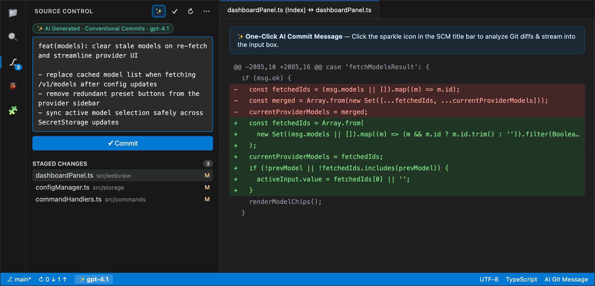
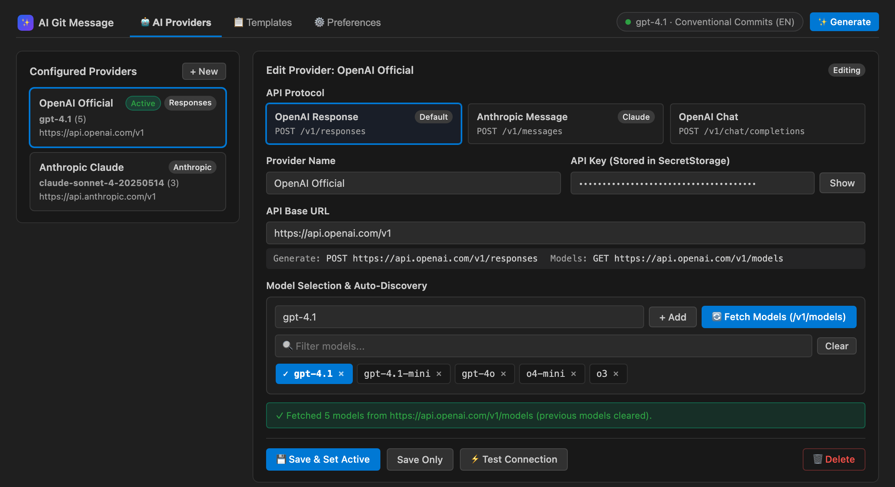
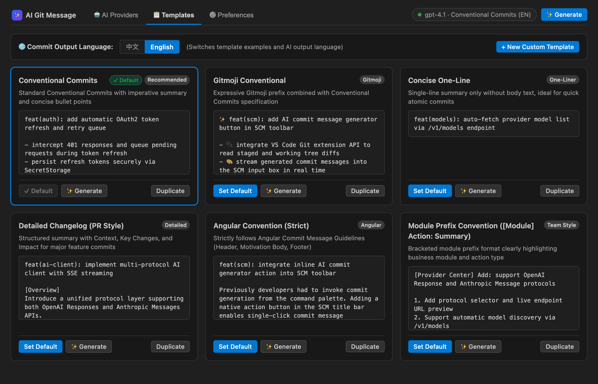
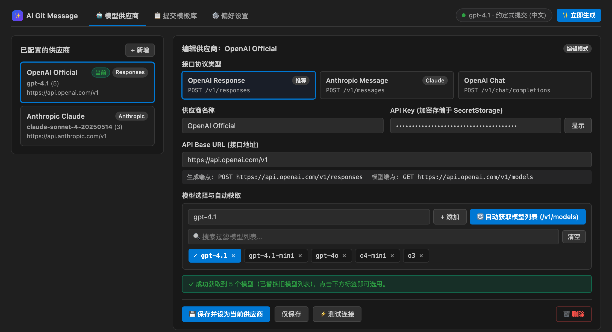
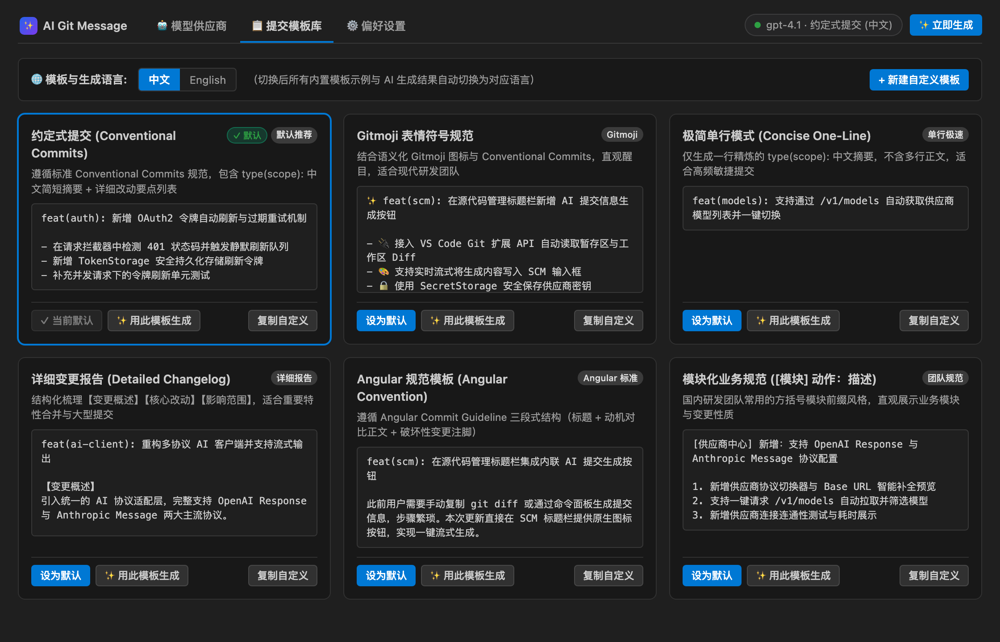

# AI Git Message

<p align="center">
  
</p>

<p align="center">
  <strong>Smart AI Commit Message Generator for VS Code Source Control</strong><br/>
  在 VS Code 源代码管理处一键生成高质量 Git 提交信息
</p>

<p align="center">
  <a href="#english">English</a> · <a href="#简体中文">简体中文</a>
</p>

---

## English

**AI Git Message** integrates directly into the VS Code **Source Control (`scm/title`)** toolbar right next to the Commit (`✓`) button. With one click, it analyzes your Git diff and streams clean, structured commit messages into the SCM input box. It natively supports **OpenAI Response (`/v1/responses`)**, **Anthropic Message (`/v1/messages`)**, and **OpenAI Chat (`/v1/chat/completions`)** protocols, automatic model discovery via `GET /v1/models`, and customizable bilingual commit templates.

### 📸 Screenshots

#### 1. One-Click Streaming Generation in Source Control
Click the `✨` sparkle icon in the Source Control toolbar to analyze Staged or Working Tree changes and stream the commit message in real time.



#### 2. Multi-Protocol AI Provider Settings & Auto Model Discovery
Configure OpenAI Response, Anthropic Message, or OpenAI Chat providers with live endpoint previews, `SecretStorage` API key encryption, and one-click `/v1/models` model list discovery.



#### 3. Built-in & Custom Commit Message Templates
Switch between 6 professional built-in commit conventions, toggle output language (`中文` / `English`) with one click, or duplicate/create your own custom templates.



### ✨ Key Features

1. **Native Source Control Integration (`scm/title`)**
   - Adds a native `$(sparkle)` button right next to the `✓` Commit action in **Source Control -> Changes**.
   - Automatically inspects **Staged Changes** first (falling back to Working Tree changes when nothing is staged) and **streams** the generated commit message directly into the SCM input box.
   - Displays a spinning stop button while generating so you can cancel at any time.
   - Quick access from the SCM `...` menu and the VS Code bottom **Status Bar** to switch models, templates, or open the Settings Center.

2. **Multi-Protocol AI Providers & Auto Model Discovery**
   - **OpenAI Response (`POST /v1/responses`)**: Supports both SSE streaming (`response.output_text.delta`) and non-streaming responses.
   - **Anthropic Message (`POST /v1/messages`)**: Supports SSE streaming (`content_block_delta`) and non-streaming responses, compatible with both `x-api-key` and `Bearer` gateway authentication.
   - **OpenAI Chat Completions (`POST /v1/chat/completions`)**: Compatible with OpenAI-compatible relay gateways and local model servers.
   - **Auto Model Discovery (`GET /v1/models`)**: Fetch and refresh available models directly from your provider with instant keyword filtering.
   - **Secure Credential Storage**: API keys are stored exclusively in VS Code's OS-backed `SecretStorage` — never written in plain text to `settings.json`.

3. **Built-in & Custom Commit Templates**
   - **Conventional Commits** *(Default)*
   - **Gitmoji Conventional**
   - **Concise One-Line**
   - **Detailed Changelog (PR Style)**
   - **Angular Convention (Strict)**
   - **Module Prefix Convention (`[Module] Action: Summary`)**
   - One-click duplication of built-in templates and full custom System Prompt support.

### 🚀 Quick Start

1. Click the `✨ AI Git (Setup)` item in the bottom Status Bar, or run **`AI Git Message: Open AI Git Message Settings Center`** from the Command Palette (`Cmd+Shift+P` / `Ctrl+Shift+P`).
2. Select an API protocol (`OpenAI Response`, `Anthropic Message`, or `OpenAI Chat`), enter your **Provider Name**, **API Base URL**, and **API Key**.
3. Click **`🔄 Fetch Models (/v1/models)`** (or enter a model ID manually), select a model chip, and click **`Save & Set Active`**.
4. Open the **Source Control** view in any Git repository and click **`✨`** to generate your commit message!

### ⚙️ Extension Settings

| Setting | Default | Description |
| :--- | :--- | :--- |
| `aiGitMessage.commitLanguage` | `"auto"` | Output language for commit messages (`"auto"`, `"zh"`, `"en"`). |
| `aiGitMessage.diffScope` | `"auto"` | Diff scope analyzed: `"auto"` (Staged first), `"staged"`, or `"all"`. |
| `aiGitMessage.streamOutput` | `true` | Stream generated commit messages into the SCM input box in real time. |
| `aiGitMessage.askTemplateBeforeGenerate` | `false` | Prompt to pick a template every time the Generate button is clicked. |
| `aiGitMessage.maxDiffLines` | `1500` | Maximum diff lines sent to the AI model (lockfiles are filtered automatically). |
| `aiGitMessage.customInstructions` | `""` | Global extra instructions appended to all templates (e.g., JIRA issue rules). |
| `aiGitMessage.showStatusBar` | `true` | Show the active model & template quick switcher in the VS Code status bar. |

---

## 简体中文

在 VS Code **源代码管理 (Source Control)** 标题操作栏（提交 `✓` 按钮左侧）提供一键 AI 生成 Git Commit Message 按钮，支持多套专业提交信息模板切换与自定义，完整支持 **OpenAI Response (`/v1/responses`)**、**Anthropic Message (`/v1/messages`)** 与 **OpenAI Chat (`/v1/chat/completions`)** 协议供应商，并支持通过 `/v1/models` 自动拉取与更新模型列表。

### 📸 界面预览

#### 1. 源代码管理栏一键流式生成
在「源代码管理」标题栏点击 `✨` 按钮，自动读取暂存区或工作区 Git Diff，并将生成的提交信息实时流式写入提交输入框。


#### 2. AI 模型供应商管理与模型自动获取
可视化管理多协议供应商，实时预览生成与模型端点地址，API Key 加密存储于 `SecretStorage`，支持一键拉取并刷新 `/v1/models` 模型列表。



#### 3. 多套专业提交模板库与中英文一键切换
内置 6 套主流团队提交规范，支持顶部一键切换中/英文输出语言，也可随时复制修改内置模板或新建自定义模板。



### ✨ 核心特性

1. **原生源代码管理操作栏集成 (`scm/title`)**
   - 在「源代码管理 -> 更改」右侧工具栏（`✓` 提交按钮左侧）嵌入原生 `$(sparkle)` 按钮。
   - 点击即可读取当前仓库暂存区（Staged，优先）或工作区（Working Tree）的 Git Diff，并将生成的提交信息**实时流式写入**提交输入框。
   - 生成过程中按钮自动切换为停止状态，支持随时点击中断取消。
   - 在右侧 `...` 更多菜单与底部状态栏同步提供**切换模板**、**切换模型**、**打开配置中心**快捷入口。

2. **多协议 AI 供应商管理 + 模型列表自动获取**
   - **OpenAI Response 协议 (`POST /v1/responses`)**：支持流式 `response.output_text.delta` 与非流式 `output` 解析。
   - **Anthropic Message 协议 (`POST /v1/messages`)**：支持流式 `content_block_delta` 与非流式 `content` 解析，兼容 `x-api-key` 与 `Bearer` 网关鉴权。
   - **OpenAI Chat Completions 兼容 (`POST /v1/chat/completions`)**：兼容各类中转网关与本地模型服务。
   - **自动获取模型列表 (`GET /v1/models`)**：在配置中心或命令面板点击「🔄 自动获取模型列表」即可拉取最新支持的模型并自动替换旧模型列表，支持关键词搜索过滤与一键清空。
   - **安全密钥存储**：API Key 全程保存在 VS Code 原生 `SecretStorage` 系统级凭据库中，不以明文落盘至 `settings.json`。

3. **多套内置 Git Message 模板 + 自定义模板库**
   - **约定式提交 (Conventional Commits)** *(默认)*
   - **Gitmoji 表情符号规范 (Gitmoji Conventional)**
   - **极简单行模式 (Concise One-Line)**
   - **详细变更报告 (Detailed Changelog)**
   - **Angular 规范模板 (Angular Convention)**
   - **模块化业务规范 (`[模块] 动作：描述`)**
   - 支持一键切换**中文 / English** 生成语言，支持**复制并修改内置模板**或**新建自定义模板**。

### 🛠️ 开发、调试与打包安装

#### 1. 安装依赖与编译
```bash
npm install
npm run compile
```

#### 2. 在 VS Code 中按 F5 调试运行
1. 使用 VS Code 打开本项目目录。
2. 按下 `F5`，启动 **Extension Development Host** 调试窗口。
3. 打开任意包含 Git 仓库的项目，切到左侧 **源代码管理 (Source Control)** 视图，即可在 `✓` 提交按钮左侧看到 `✨` 按钮。

#### 3. 打包为 `.vsix` 本地安装
```bash
npx @vscode/vsce package
```
生成 `.vsix` 安装包后，在 VS Code 扩展面板点击右上角 `...` -> **从 VSIX 安装 (Install from VSIX...)** 即可安装使用。
